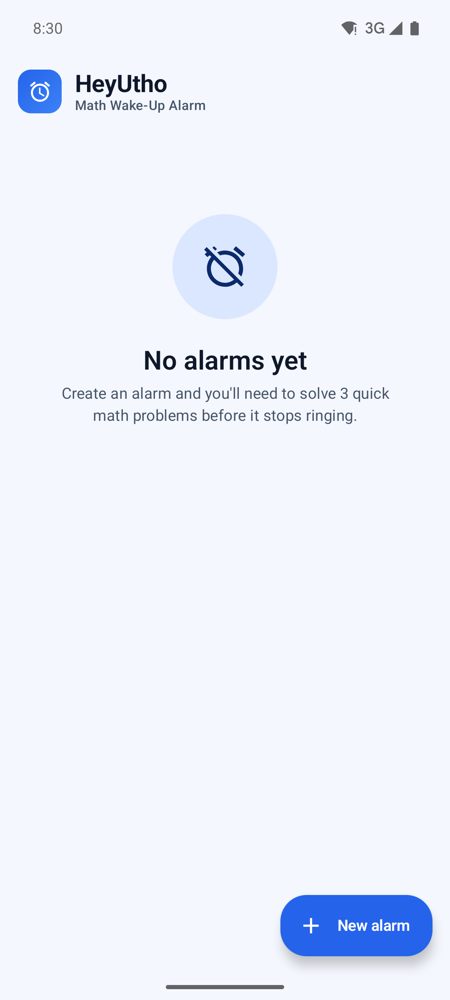
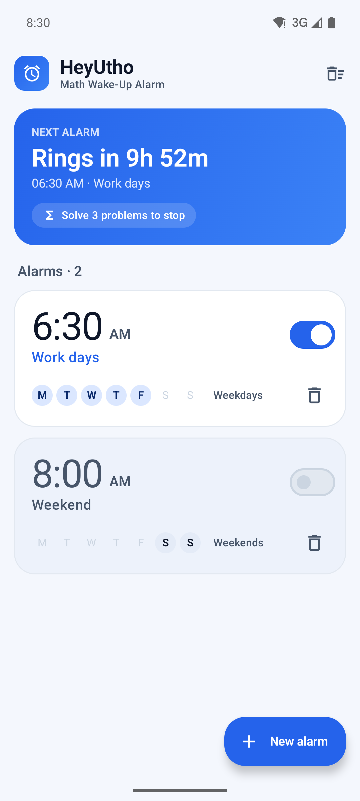
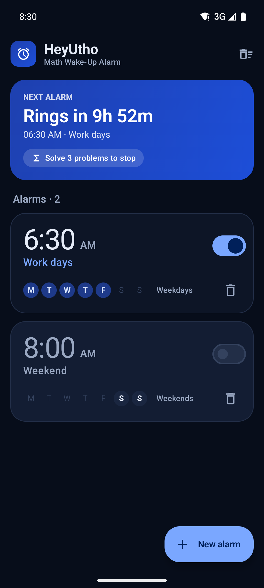
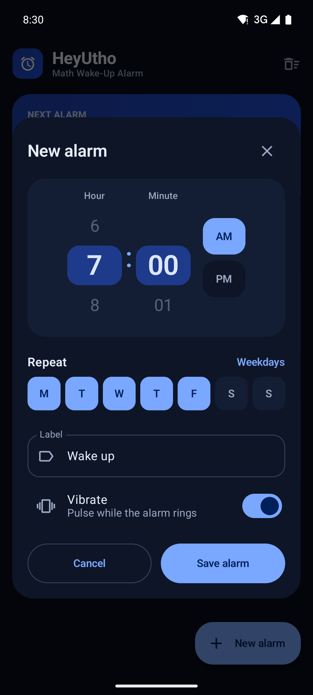
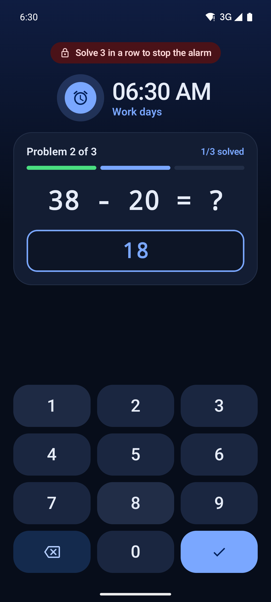
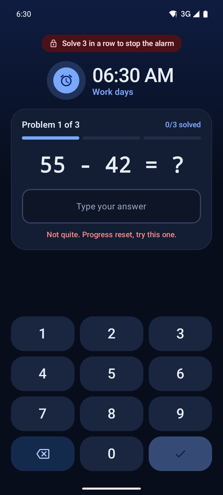
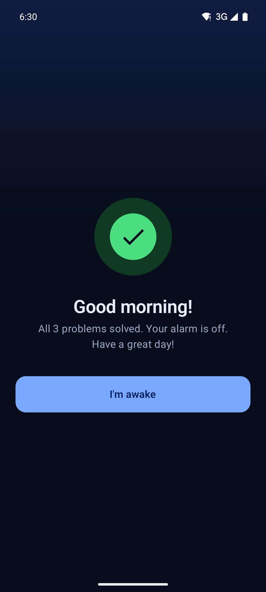

<div align="center">


# HeyUtho

**The alarm clock you can't snooze. Solve 3 math problems to turn it off.**

[](https://github.com/SajibAhmedNls/MathChallangeAlarm/releases/latest)
[](https://github.com/SajibAhmedNls/MathChallangeAlarm/actions/workflows/ci.yml)
[](#requirements)
[](https://kotlinlang.org/)
[](https://developer.android.com/jetpack/compose)
[](LICENSE)

[**Download the latest APK**](https://github.com/SajibAhmedNls/MathChallangeAlarm/releases/latest) · [Report a bug](https://github.com/SajibAhmedNls/MathChallangeAlarm/issues/new) · [Request a feature](https://github.com/SajibAhmedNls/MathChallangeAlarm/issues/new)

</div>

---

## Why HeyUtho?

Snooze buttons are too easy to hit half-asleep. HeyUtho makes your brain do a little work first: when the alarm rings, you have to solve **three arithmetic problems in a row** before it stops. By the time you're done, you're awake.

It's free, open source, has no ads, needs no account, and keeps all data on your device.

## Screenshots

| First launch | Alarms (light) | Alarms (dark) | Create / edit |
| :---: | :---: | :---: | :---: |
|  |  |  |  |

| Math challenge | Wrong answer | Alarm stopped |
| :---: | :---: | :---: |
|  |  |  |

## Features

**Wake-up challenge**
- Solve 3 two-digit addition or subtraction problems in a row to stop the alarm.
- A wrong answer resets your progress, so guessing doesn't work.
- Large on-screen keypad with haptic feedback, built for sleepy fingers.

**Hard to escape**
- Keeps ringing if you swipe the app away. Sound runs in a separate foreground service process.
- Back button and volume keys are blocked while the alarm rings.
- Shows over the lock screen and turns the display on.
- Alarms are restored automatically after the phone restarts.

**Simple alarm management**
- Scroll-wheel time picker with AM/PM.
- Repeat on any days of the week, with clear summaries like "Weekdays" or "Weekends".
- Custom labels and per-alarm vibration.
- "Next alarm" card with a live countdown.
- Delete one alarm or all of them, always with confirmation.

**Modern design**
- Blue Material 3 theme with automatic light and dark mode.
- The ringing screen is always dark, so it won't blind you in the morning.
- Accessible: high-contrast colors, 48dp touch targets, and screen-reader labels.

## Download & install

1. Open the [latest release](https://github.com/SajibAhmedNls/MathChallangeAlarm/releases/latest) on your Android phone.
2. Download `HeyUtho-<version>.apk`.
3. Open the file. If Android asks, allow installs from your browser or file manager.
4. On first launch, allow **notifications**. On Android 12+, also make sure **Alarms & reminders** is allowed for the app so alarms ring on time.

> **Tip:** Some phones (Xiaomi, Oppo, Vivo, Samsung and others) aggressively stop background apps. For the most reliable alarms, set HeyUtho's battery usage to **Unrestricted** in system settings.

## Requirements

| | |
| --- | --- |
| Android version | 7.0 (API 24) or newer |
| Target SDK | 36 |
| Network | Not required |

## Permissions

HeyUtho only asks for what an alarm clock needs:

| Permission | Why it's needed |
| --- | --- |
| `SCHEDULE_EXACT_ALARM`, `USE_EXACT_ALARM` | Ring at exactly the time you set |
| `POST_NOTIFICATIONS` | Show the ringing notification (Android 13+) |
| `FOREGROUND_SERVICE`, `FOREGROUND_SERVICE_MEDIA_PLAYBACK` | Keep playing the alarm sound until you solve the challenge |
| `USE_FULL_SCREEN_INTENT`, `DISABLE_KEYGUARD` | Show the math challenge over the lock screen |
| `WAKE_LOCK` | Wake the phone when the alarm fires |
| `VIBRATE` | Vibrate with the alarm |
| `RECEIVE_BOOT_COMPLETED` | Restore your alarms after a restart |

## Build from source

### Prerequisites

- [Android Studio](https://developer.android.com/studio) (latest stable), or
- JDK 17–25 plus the Android SDK (platform 36)

### Steps

```bash
git clone https://github.com/SajibAhmedNls/MathChallangeAlarm.git
cd MathChallangeAlarm

# One-time: create the local debug signing key the build expects
keytool -genkeypair -keystore debug.keystore -alias androiddebugkey \
  -storepass android -keypass android -keyalg RSA -keysize 2048 \
  -validity 10000 -dname "CN=Android Debug,O=Android,C=US"

# Build a debug APK -> app/build/outputs/apk/debug/app-debug.apk
./gradlew :app:assembleDebug

# Install on a connected device or emulator
./gradlew :app:installDebug

# Run unit tests
./gradlew :app:testDebugUnitTest
```

On Windows, use `gradlew.bat` instead of `./gradlew`.

## Architecture

HeyUtho is a single-activity Jetpack Compose app using **MVVM** with a repository layer.

```text
app/src/main/java/com/hellosajib/alarmapp/
├── MainActivity.kt               # Entry point, lock-screen flags, screen switching
├── alarm/
│   ├── AlarmScheduler.kt         # AlarmManager exact scheduling + next-trigger math
│   ├── AlarmReceiver.kt          # Fires alarms, reschedules after reboot
│   ├── AlarmRingingService.kt    # Foreground service (separate process) that rings
│   ├── AlarmAudioPlayer.kt       # Looping sound + vibration
│   ├── AlarmLockManager.kt       # Persists "ringing" state across process death
│   └── AlarmStateHolder.kt       # In-memory state for the active alarm
├── data/                         # Room database: entity, DAO, repository
├── math/MathEngine.kt            # Random problem generator and answer checker
└── ui/
    ├── AlarmViewModel.kt         # UI state, alarm CRUD, math challenge logic
    ├── screens/                  # Alarm list, ringing / challenge screen
    ├── dialogs/                  # Create / edit alarm dialog
    ├── components/               # Math card, numeric keypad, repeat-day helpers
    └── theme/                    # Blue Material 3 color schemes, type, shapes
```

**How an alarm rings:**

1. `AlarmScheduler` registers an exact alarm with `AlarmManager.setExactAndAllowWhileIdle`.
2. At trigger time, `AlarmReceiver` starts `AlarmRingingService`, a foreground service in its own `:alarm_service` process. Killing the UI can't stop the sound.
3. The service posts a full-screen notification that opens `MainActivity` over the lock screen.
4. `AlarmViewModel` runs the 3-problem challenge. Only a full streak stops the service.

**Tech stack:** Kotlin · Jetpack Compose · Material 3 · Room · Coroutines & StateFlow · AlarmManager · Foreground services

## Releasing (maintainers)

Releases are built, signed and published by GitHub Actions ([`release.yml`](.github/workflows/release.yml)).

**Version format:** `YEAR.MONTH.PATCH.RUN`, for example `2026.10.1.7`. The workflow run number is also the Android `versionCode`, so every release installs as an upgrade.

**One-time setup:** add these repository secrets under *Settings → Secrets and variables → Actions*:

| Secret | Value |
| --- | --- |
| `KEYSTORE_BASE64` | Your release keystore, base64-encoded (`base64 -i release.jks \| tr -d '\n'`) |
| `STORE_PASSWORD` | Keystore password |
| `KEY_PASSWORD` | Key password (key alias must be `upload`) |

**Releases are automatic:** every push or merged pull request to `main` first runs **CI** (unit tests and a debug build). **Only if CI passes**, the release workflow:

1. builds a signed APK and AAB from the exact commit CI tested,
2. creates the tag and a GitHub Release with auto-generated notes.

If CI fails, nothing is released. You can also start a release by hand from *Actions → Production Release → Run workflow* (optionally with a custom version prefix); manual runs execute the unit tests themselves.

The workflow refuses to run without the signing secrets. This prevents publishing an APK signed with a throwaway key that users couldn't upgrade.

## Contributing

Contributions are welcome!

1. Fork the repo and create a branch: `git checkout -b feature/my-change`
2. Make your change and run `./gradlew :app:testDebugUnitTest`
3. Open a pull request describing **what** changed and **why**. Add screenshots for UI changes.

Please keep the core promise intact: the alarm must never be dismissable without solving the challenge.

Good first contributions: translations, more problem types (multiplication, difficulty levels), custom ringtones, and UI tests.

## Credits

- Created by Sajib ([@SajibAhmedNls](https://github.com/SajibAhmedNls)). *"Utho"* means *"Wake up"* in Bengali, so HeyUtho is a friendly "Hey, wake up!"
- Blue redesign and release pipeline by [@toufikforyou](https://github.com/toufikforyou)

## License

Released under the [MIT License](LICENSE).
